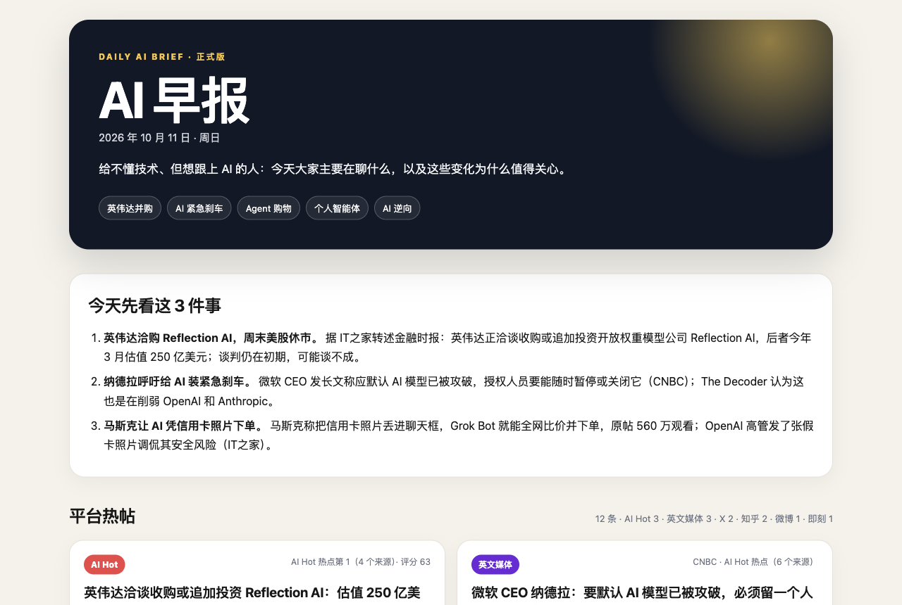
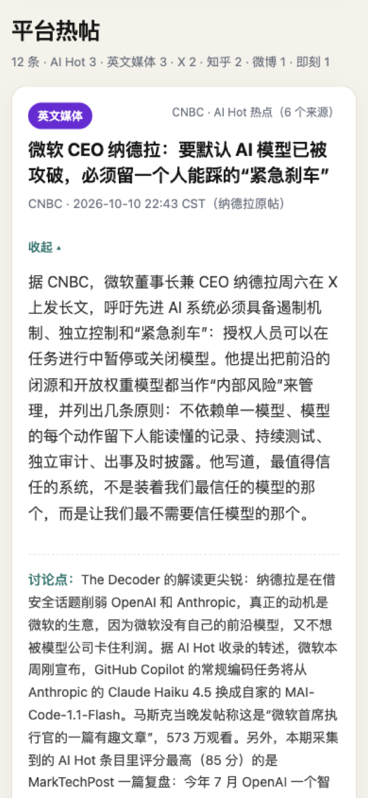

# AI Morning Brief · AI 早报

[中文](README.md) | **English**

A Chinese-language AI news brief that publishes itself every afternoon, written for people who are not technical but want to keep up with AI. It collects, selects, writes, self-checks, builds a web page, publishes it, and pushes a notification to my phone, with nobody watching.

**[Read the latest issue](https://506218109-oss.github.io/ai-morning-brief/latest.html)** · [Archive](https://506218109-oss.github.io/ai-morning-brief/) (issues are in Chinese)

| Desktop | Phone: scan the headlines | Phone: tap to expand |
|---|---|---|
|  |  |  |

## What happens every day

```
15:00  A scheduled task starts (Claude desktop app; a fresh session every run)
  │
  ├─ 1. Collect (about 3 minutes, fixed scripts)
  │     AI Hot API · aihot.today · GitHub Trending · Jike
  │     13 X accounts · 11 Weibo bloggers · Zhihu hot list
  │     (read-only, through a browser that is already signed in on my own Mac)
  │
  ├─ 2. Select and write (AI, following the editorial rules in the runbook)
  │     12 stories + 3 GitHub projects, each with "what this means for
  │     people who work in operations and content"
  │
  ├─ 3. Verify (AI goes back to the raw data and checks every number,
  │     time, and quote)
  │
  ├─ 4. Build the page (fixed script with built-in checks; no page is
  │     produced if a check fails)
  │
  ├─ 5. Publish to GitHub Pages and wait until the live page has updated
  │
  └─ 6. Push to my phone through Bark: three headlines and a link
```

A full run takes about 20 minutes. If the scheduled time is missed (the laptop lid was closed, for example), the run starts the next time the Mac is opened. If today's issue has already been pushed, the run exits without sending it again.

## Why I built my own

There is no shortage of AI newsletters. I built this one because I had tried three setups before, and each of them failed on one specific problem:

| What I tried | Why it stopped working |
|---|---|
| A scheduled task that kept running in one long chat thread | The thread kept growing, and by the third day the request was too large to send |
| A fully cloud-hosted agent | The cloud has no signed-in sessions, so it could not read original posts on X, Weibo, or Zhihu. It paraphrased second-hand coverage, linked to home pages, and could only give approximate times |
| A pipeline that ran, but needed me to fix it every few days | Being unreliable is worse than being mediocre. Automation that needs watching is not automation |

So the priorities for this version are: **first make it run without me, then make the content good.**

## Key design decisions

**1. Scripts do what is deterministic. The AI only does what needs judgment.**
Collecting, building, publishing, and pushing are fixed scripts, and the same code runs every day. The AI has two jobs: choosing stories from what was collected, and writing them up. When something goes wrong, it is obvious whether a script broke or the AI made a bad call.

**2. Collect on my own machine. Use the cloud only to display.**
Most of my sources are specific people on X and Weibo. Getting their original posts, exact timestamps, and real engagement numbers requires a signed-in browser. So collection runs locally (read-only: no likes, no posts), and the finished page lives on GitHub Pages, where my phone can open it from anywhere.

**3. Three gates against made-up content.**
- Before writing: every number, time, and quote is checked against the raw data or the original article. Figures that appear only on aggregator sites, with no second source, are not used.
- After writing: a line-by-line self-review against a checklist. The usual offenders are phrases the source never said, such as "commenters disagreed", "for several days", "the largest", or "the first". Every issue so far has needed corrections, sometimes more than a dozen.
- At build time: the script checks the item count, the per-platform cap, link formats, and that every story has its "what this means" line. If any check fails, no page is produced.
- Paywalls and login walls are never bypassed. The footer of each issue states what could not be collected.

**4. The editorial rules live in a runbook, not buried in a prompt.**
[RUNBOOK.md](RUNBOOK.md) is the only document the daily AI run reads: what to pick, how to rank, how to verify, and what to do when something fails. The rules came out of comparing versions and correcting mistakes. For example:
- The biggest business or market story of the day must be included, with the market reaction and its source (facts only, never investment advice).
- Rank by real attention, and do not drop a story just because it ran yesterday. If a topic stays hot for days, it stays in the brief for days.
- Every story must answer: what does this mean for people working in operations and content?

**5. "Unattended" breaks on very small details.**
- Permissions: the app remembers approvals by the exact text of a command. If a command contains the date, tomorrow it is a command the app has never seen, and it stops to ask again. The fix is a single entry point, `run.py`, which works out the date itself, so the commands are identical every day.
- Slow collection: simulated mouse-wheel scrolling took more than 20 seconds per scroll when the browser window was not in front, which stretched a 5-minute run to 18 minutes. Scrolling the page directly brought it back under 3 minutes.
- Notifications: sent only between 11:00 and 22:00, never twice for the same issue, and only after the live page has updated, so the link never opens a stale page.

**6. On a phone: scan first, then read what you choose.**
The mobile layout is a two-column grid of headline cards, about eight to a screen. Tapping a card expands it in place to full width. Expanding and collapsing are pure CSS. The only script is a few lines on the bottom "collapse" button, which scrolls the page back to the card after it closes. Older browsers fall back to a single column of full cards.

**7. Review before shipping.**
Before the mobile layout went live, three independent AI reviewers examined it from different angles (browser compatibility, layouts with different item counts, and real click testing), and a fourth reproduced each finding. They raised 16 issues, and 9 were confirmed. Two of them were real bugs my own testing had missed, including one where tapping a right-column card made its content drop to the next row.

## Sources

| Source | What | How |
|---|---|---|
| [AI Hot](https://aihot.news/) | Chinese AI news aggregator with scores and editor notes | Official anonymous read-only API |
| [aihot.today](https://aihot.today/) | Sections for TechCrunch, 36Kr, WSJ, and others | Public page |
| GitHub Trending | Trending repositories of the day | Public page |
| Jike | The "AI 探索站" topic and 3 bloggers | Public pages |
| X | 13 accounts (official accounts, aggregators, Chinese-language bloggers) | Signed-in local browser, read-only |
| Weibo | 11 tech and AI bloggers | Signed-in local browser, read-only |
| Zhihu | AI-related questions on the hot list | Signed-in local browser, read-only |

The list is in [sources.json](sources.json). To add or remove a source, edit that one file.

## What is in the repository

| File | Purpose |
|---|---|
| `run.py` | The single entry point. The daily run uses only its subcommands |
| `collect_web.py` / `collect_browser.mjs` | Collection |
| `digest.py` | Turns the collected data into one candidate list |
| `build.py` + `template/style.css` | Builds the page and runs the checks |
| `publish.py` | Publishes to GitHub Pages |
| `push_bark.py` | Sends the phone notification |
| `RUNBOOK.md` | The runbook: steps, editorial rules, red lines, failure handling (in Chinese) |
| `sources.json` | The source list |
| `examples/` | One issue as JSON, and the page built from it |
| `docs/` | Screenshots, the scheduled-task prompt, and example permission rules |

## Running it yourself

You need macOS, Python 3.9+, the [GitHub CLI](https://cli.github.com/) (signed in), the [ego lite](https://lite.ego.app/) browser (it provides the `ego-browser` command), [Bark](https://bark.day.app/) on an iPhone, and the Claude desktop app for its scheduled tasks.

1. Clone the repository. In ego lite, sign in to your own X, Weibo, and Zhihu accounts.
2. Copy `config/local.example.json` to `config/local.json` and fill in the repository that will host the pages. It needs a `gh-pages` branch with Pages enabled.
3. Put your Bark device key in `config/bark-key.txt`, then run `chmod 600 config/bark-key.txt`.
4. Run each step once by hand to confirm it works:

   ```bash
   python3 run.py status     # where today's run stands
   python3 run.py collect    # collect, about 3 minutes
   # have Claude select and write per RUNBOOK.md, saved as issues/<date>.json
   python3 run.py build      # build and check
   python3 run.py publish    # publish
   python3 run.py push --send
   ```

5. In the Claude desktop app, create a daily scheduled task using the prompt in [docs/scheduled-task-prompt.md](docs/scheduled-task-prompt.md). Then add `run.py` to the allow rules as shown in [docs/claude-permissions.example.json](docs/claude-permissions.example.json), so the daily run never stops to ask for permission.

## Known limits

- The Mac must be awake and the Claude app open at the scheduled time. A missed run starts the next time the Mac is opened.
- It depends on the browser staying signed in. If a session expires, the brief still goes out without that platform, and the run report says so.
- When a paywalled outlet such as WSJ cannot be opened, the paywall is not bypassed. The brief cites only what can be verified, or uses a source with a public article.
- It has only been run on macOS.

## Terms of use

- This is a personal, non-commercial project for learning and my own use.
- It only reads public content. It never likes, posts, follows, or changes anything. Check and follow each platform's terms of service yourself, keep request rates low, and use it at your own risk.
- The AI Hot API is free for personal non-commercial use. For anything else, read its [terms](https://aihot.news/terms) first.
- Summaries are written by an AI and may contain errors. Original posts and articles belong to their authors.
- Anything about markets or share prices reports facts and sources only. It is not investment advice.
- The repository contains no keys or account information. See [SECURITY.md](SECURITY.md).

## How this project was made

I work in internet operations. I am not a programmer. In this project:

- **My part**: deciding what problem to solve, curating the source list, setting the editorial rules, making the layout trade-offs, giving feedback on every version, and deciding when something counted as done.
- **Claude Code's part**: writing and testing all of the code, and the daily selection and writing, following the runbook I defined.

How it got here:

| When | Version | Outcome |
|---|---|---|
| 2026-09 | v1: a Codex scheduled task | Worked for two issues, then stopped because I kept it in one chat thread and the context grew too large |
| 2026-09 | v2: a pipeline built with WorkBuddy | Published daily, but I was not happy with the content and it often needed manual fixes |
| 2026-10 | v3: a cloud-hosted agent | Could not read original posts on X, Weibo, or Zhihu |
| 2026-10 | This version: local collection + a Claude Code scheduled task | Running daily |

## License

[MIT](LICENSE)
